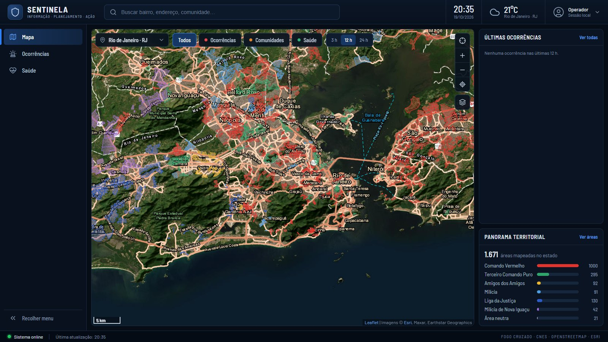
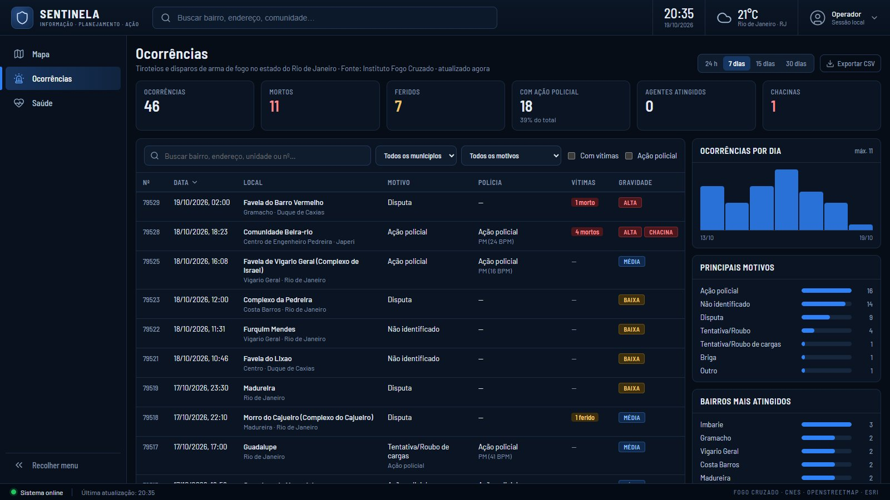
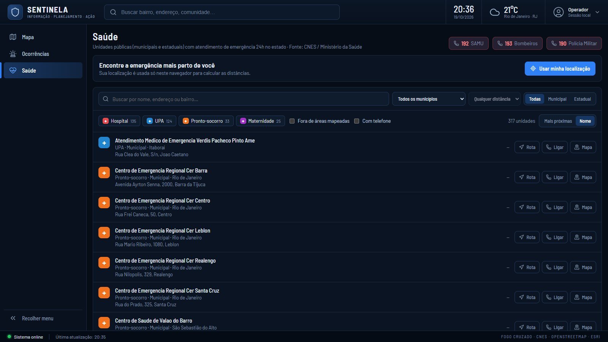
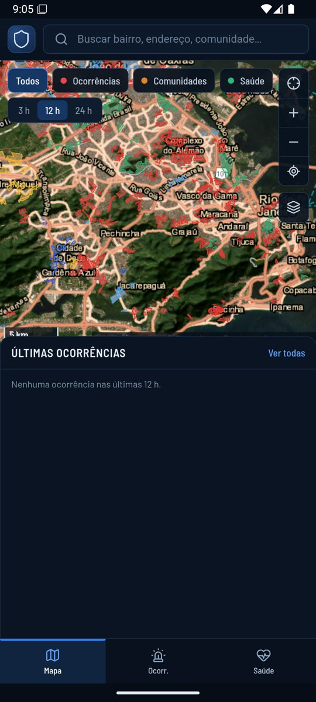
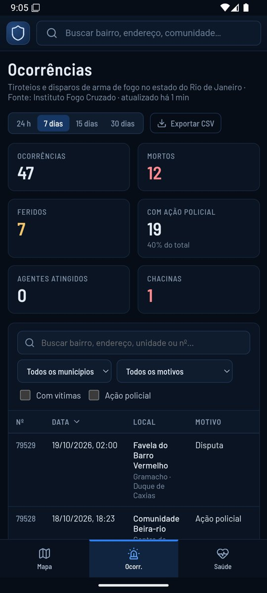
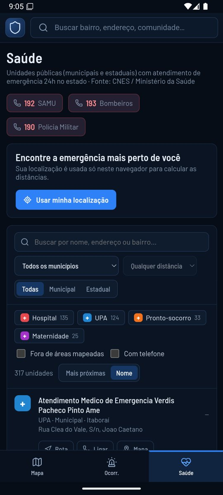
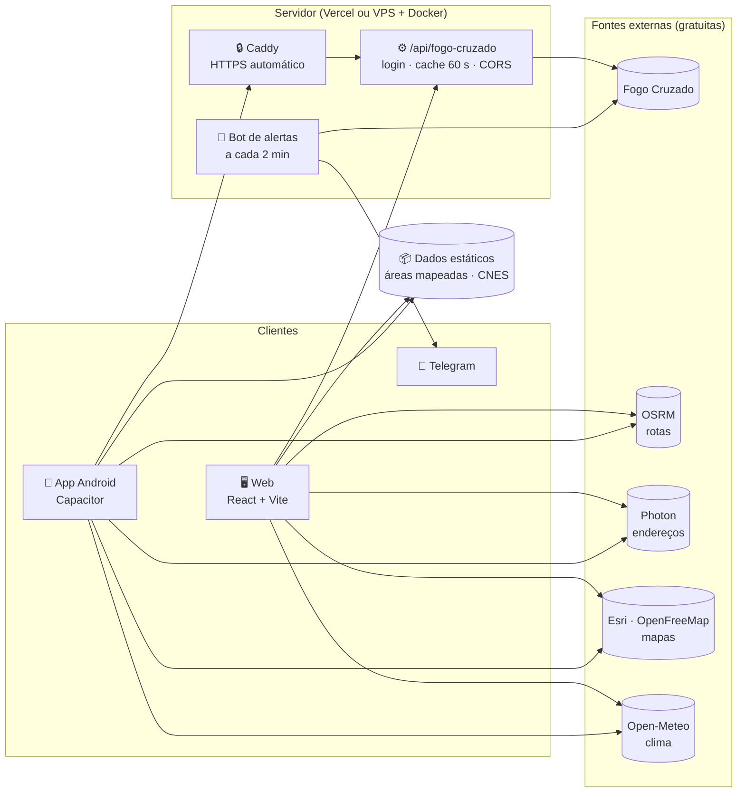

<div align="center">


# SENTINELA

**Informação · Planejamento · Ação**

Central de comando de segurança para quem circula pelo Rio de Janeiro: tiroteios em tempo quase real,<br />
territórios mapeados, rotas seguras, emergências públicas e alertas no Telegram, num só painel.

<br />


<br />


<br />

[Funcionalidades](#-funcionalidades) ·
[Telas](#-telas) ·
[Arquitetura](#-arquitetura) ·
[Começando](#-começando) ·
[Fontes de dados](#-fontes-de-dados) ·
[Documentação](docs/DOCUMENTACAO.md)

<br />



</div>

<br />

## ✦ Sobre

O **Sentinela** nasceu de uma pergunta simples: *qual caminho é mais seguro?*
Ele traça rotas como o Waze ou o Google Maps, mas cruza cada trajeto com as **1.671 áreas mapeadas** com presença de facções e milícias no RJ e com os **tiroteios registrados nas últimas horas**.
O resultado é uma nota de exposição para cada rota.

A partir daí, virou uma central de comando completa:
- painel de ocorrências com estatísticas;
- localizador de emergências públicas;
- alerta de proximidade por GPS;
- bot que avisa no Telegram quando algo acontece perto de você;
- app Android.

> [!IMPORTANT]
> O Sentinela é uma ferramenta **informativa e de segurança pessoal**. O controle territorial muda o tempo todo, e os dados podem estar atrasados ou incompletos.
> A ausência de alerta **não significa** que um local é seguro. Em emergência, ligue **190**, **192** ou **193**.

<br />

## ✦ Funcionalidades

<table>
<tr>
<td width="50%" valign="top">

### 🚨 Ocorrências em tempo quase real
Tiroteios e ações policiais do **Instituto Fogo Cruzado**, atualizados a cada 2 minutos.
- Períodos de 24 h, 7, 15 ou 30 dias, com busca e filtros por município, motivo, vítimas e ação policial.
- Gráficos por dia, motivos, bairros e perfil das vítimas.
- Exportação em CSV.
- Gravidade calculada automaticamente.

</td>
<td width="50%" valign="top">

### 🗺️ Rotas com consciência territorial
Até 5 rotas alternativas, com tempo e distância, de carro, bicicleta ou a pé. Cada rota recebe uma **nota de 0 a 100**, que considera:
- os trechos dentro ou a menos de 150 m de áreas mapeadas;
- os tiroteios das últimas 6 h perto do trajeto.

O destino também é avaliado.

</td>
</tr>
<tr>
<td valign="top">

### 🏥 Saúde e emergências
**317 unidades públicas 24h** (hospitais, UPAs, prontos-socorros e maternidades), vindas do CNES.
- Mostra a mais próxima de você e traça a rota com um toque.
- Liga direto para a unidade.
- Avisa se a unidade fica dentro de uma área mapeada.
- Atalhos para 192, 193 e 190.

</td>
<td valign="top">

### 📡 Alerta de proximidade
Acompanha o GPS e avisa quando você entra numa área mapeada, se aproxima de uma ou passa perto de um tiroteio recente.
- Raio de 500 m, 1 km ou 2 km.
- Aviso por janela na tela, vibração, bipes ou voz.
- Mantém a tela ligada enquanto monitora.

</td>
</tr>
<tr>
<td valign="top">

### 🤖 Bot do Telegram
Cada ocorrência nova do RJ chega no seu Telegram.
- As que ficam **perto dos seus locais** chegam com som e destaque; as demais chegam em silêncio.
- Comandos `/addlocal`, `/raio`, `/modo`, `/ultimas`, `/status`.
- Bot privado, roda em Docker.
- 📘 [Manual do bot (PDF)](docs/manual-bot-telegram.pdf)

</td>
<td valign="top">

### 📱 App Android
O mesmo sistema empacotado com **Capacitor**, com GPS nativo, ícone e tela de abertura próprios.
- A API das ocorrências roda na sua VPS, com HTTPS automático (Caddy + Let's Encrypt).
- O login do Fogo Cruzado nunca vai dentro do app.

</td>
</tr>
</table>

**E mais:**
- busca global de bairros, endereços e comunidades;
- 8 estilos de mapa, incluindo satélite, *Waze dia/noite* e um tema próprio;
- seletor de regiões e camadas que liga e desliga;
- clima atual;
- panorama territorial por facção.

<br />

## ✦ Telas

<div align="center">

| Ocorrências | Saúde |
|:---:|:---:|
|  |  |

**No celular (app Android)**

&nbsp;
&nbsp;


</div>

<br />

## ✦ Arquitetura



| Camada | Tecnologia |
|---|---|
| **Interface** | React 19, TypeScript, Vite 8, lucide-react, Barlow |
| **Mapas** | Leaflet + react-leaflet, MapLibre GL (estilos vetoriais), Turf.js (geometria) |
| **Servidor** | Node 24 (TypeScript nativo, sem build), Vercel Functions ou Docker + Caddy |
| **Mobile** | Capacitor 8 (Android, SDK 36) |
| **Bot** | Telegram Bot API, sem dependências, long polling |

<br />

## ✦ Começando

**Pré-requisitos:** Node 24+. Para o app Android, também JDK 21 e Android SDK 36.

```bash
git clone https://github.com/GabrielDss2411/sentinela-.git
cd sentinela-
npm install
cp .env.example .env.local      # login da API do Fogo Cruzado
npm run dev                     # http://localhost:5173
```

| Comando | O que faz |
|---|---|
| `npm run dev` | App web + API local, com recarga automática |
| `npm run build` | Checagem de tipos e build de produção |
| `npm run bot` | Bot do Telegram local (lê `.env.local` e `.env.bot`) |
| `npm run api` | API como servidor próprio (porta 8787) |
| `npm run apk` | Gera o APK Android (`.env.android` com `VITE_API_BASE`) |
| `node scripts/fetch-hospitals.mjs` | Atualiza as unidades de saúde a partir do CNES |

**Para publicar tudo na VPS** (API com HTTPS e bot):

```bash
echo "API_DOMAIN=SEU-IP.sslip.io" > deploy/.env
docker compose -f deploy/docker-compose.yml up -d --build
```

> [!TIP]
> O acesso à API do Fogo Cruzado é gratuito, mas exige solicitar autorização em [api.fogocruzado.org.br](https://api.fogocruzado.org.br/).
> Enquanto o acesso não sai, `FOGOCRUZADO_DEMO=1` mostra dados **fictícios** para testar a interface.

Passo a passo completo, variáveis de ambiente, deploy e detalhes da pontuação: **[docs/DOCUMENTACAO.md](docs/DOCUMENTACAO.md)**.

<br />

## ✦ Estrutura

```
sentinela/
├── api/            Função de servidor: proxy da API do Fogo Cruzado (Vercel ou Node)
├── bot/            Bot do Telegram (Docker)
├── server/         Servidor HTTP próprio da API, para a VPS
├── deploy/         docker-compose da VPS: API + Caddy (HTTPS) + bot
├── android/        Projeto Android (Capacitor)
├── assets/         Ícone e tela de abertura do app
├── scripts/        Atualização dos dados de saúde (CNES)
├── public/data/    Áreas mapeadas e unidades de saúde (GeoJSON)
├── docs/           Documentação técnica, manual do bot e capturas de tela
└── src/
    ├── components/ Telas e painéis (TopBar, SideNav, MapView, IncidentsScreen, HealthScreen…)
    ├── hooks/      Ocorrências, GPS/proximidade, clima, relógio
    └── lib/        Lógica: pontuação de rotas, territórios, roteamento, mapas, temas
```

<br />

## ✦ Fontes de dados

| Dado | Fonte | Atualização |
|---|---|---|
| Tiroteios e ações policiais | [Instituto Fogo Cruzado](https://fogocruzado.org.br) (API v2) | A cada 2 min |
| Áreas com presença de facções e milícias | Compilação pública via [Dados de Riscos](https://dadosderiscos.com.br) | Base de jul/2026 |
| Unidades de saúde 24h | [CNES / Ministério da Saúde](https://apidadosabertos.saude.gov.br) | Pelo script |
| Rotas | [OSRM](https://project-osrm.org) · routing.openstreetmap.de | Por consulta |
| Endereços | [Photon](https://photon.komoot.io) (komoot) | Por consulta |
| Mapas | Esri World Imagery · [OpenFreeMap](https://openfreemap.org) · © OpenStreetMap | — |
| Clima | [Open-Meteo](https://open-meteo.com) | A cada 15 min |

> [!NOTE]
> Repositório privado. As áreas mapeadas são dados de terceiros, compilados de fontes públicas. Verifique os termos da fonte antes de redistribuí-las.
> Uma área no mapa **não** é acusação contra moradores ou estabelecimentos locais.

<br />

## ✦ Próximos passos

- [ ] Publicar a API e o bot na VPS e gerar o APK com as ocorrências
- [ ] Redesenhar as telas para o celular: mapa em tela cheia com painel deslizante e cartões no lugar da tabela
- [ ] Alerta de proximidade em segundo plano no Android, com plugin nativo
- [ ] Módulos previstos: Viaturas, Pessoas e Mandados, Inteligência, Comunicações e Documentos

<br />

<div align="center">


**SENTINELA** · feito no Rio de Janeiro

</div>
